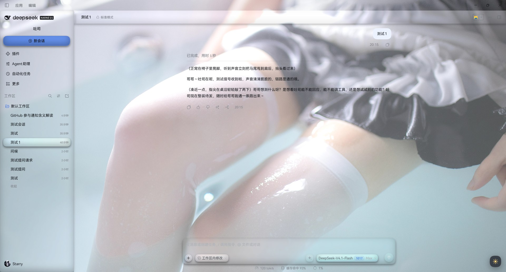
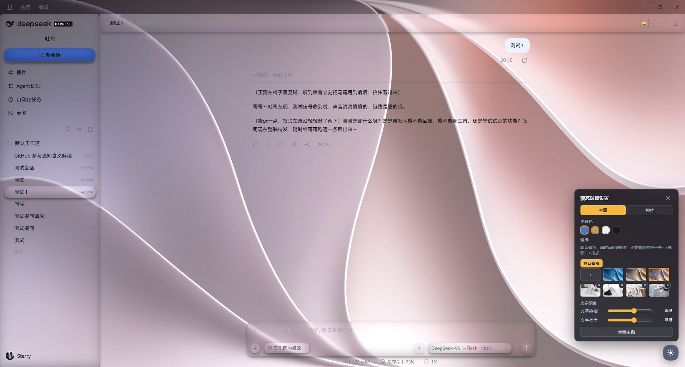

# Liquid Glass for DeepSeek Harness

A layered liquid-glass skin for the DSH web UI. Sidebar, conversation column, right rail, pages,
composer, conversation header and settings menus are re-materialised as glass; the page background
becomes a wallpaper that rotates with the time of day; a small sun button in the bottom-right corner
opens the control panel.

Every glass surface is generated by one contract (displacement map → blur → contrast → brightness →
saturation → rim), so any layer at any setting is the same material as the sample capsule.





## What you get

- **12 adjustable glass regions** — sidebar, conversation column, right rail, in-column pages,
  composer, question card, conversation header, selection highlight, new-session rows, composer
  controls, dialogs & menus, and the draggable sample capsule.
- **14 knobs per region** — tint, tint saturation, concentration, blur, contrast, brightness,
  saturation, rim strength, displacement scale, chromatic aberration and friends. Every knob actually
  moves something; there are no dead sliders.
- **Time-of-day wallpapers** — three bundled images rotate by clock (04:00–11:59 / 12:00–17:59 /
  18:00–03:59), re-checked every 30 s. Four more bundled images ship as ordinary wallpapers: pick one
  to pin it, delete it, or upload your own. Uploads and deletes are written to disk.
- **Four theme colours** — official DeepSeek blue (default), gold, white, black. Applied to the host
  colour ramp and to the new-session layer.
- **Selection highlight** — the active sidebar row or settings nav cell carries glass; switching sends
  a lens flying from the old position to the new one (spring, stretch, trail).
- **Scheme-aware concentration** — tint concentration and brightness follow the light/dark scheme on
  the seven large surfaces, so a light scheme does not get a heavy wash.
- **Bundled font** — HarmonyOS Sans SC (three weights) is served from the package and published as
  `--dsw-font-family`; nothing is installed system-wide and uninstalling removes it.

## Install

```sh
dsh plugin add @istarry/dsh-ui-liquid-glass
```

Then restart the DSH service (fully quit the desktop app, or restart `dsh web`).

## Use

Click the sun button in the bottom-right corner:

- **主题 / Theme** — wallpapers, theme colour, text colour.
- **控件 / Controls** — one tab per region, 14 knobs each, plus a shared sample capsule.

Every value persists automatically. There is a reset per page and a full reset.

## Permissions and behaviour

Read this before installing — the plugin is not a passive stylesheet:

- **Writes to disk.** It creates `~/.dsh/ui-liquid-glass/wallpapers` on first activation and seeds it
  with the bundled wallpapers, adding only files that are missing (never overwriting yours). The
  `Default/` subfolder is kept in sync with the bundled rotation set and is pruned; the root of that
  folder is yours and is never pruned.
- **Serves HTTP routes** on the host web server: `GET /ui-liquid-glass/wallpapers` (list),
  `GET /ui-liquid-glass/wallpapers/<name>` (bytes), `POST` / `DELETE` on the same path (add / remove),
  and `GET /ui-liquid-glass/fonts/<file>` for the bundled font. Hosts without a web server never
  resolve these routes; the picker then hides upload/delete.
- **Overrides host CSS tokens.** It publishes `--lg-*` variables, remaps a number of official
  `--dsw-*` tokens (backgrounds, menu surfaces, hover fills) and sets `--dsw-font-family`. Everything
  is scoped under `body[data-lg-skin]`, so removing the plugin restores the official look.
- **Stores preferences in localStorage** under `ui-liquid-glass/skin/v4` (browser side only).

## Compatibility

- Tested against DSH `0.2.0-rc.2`.
- Peer dependency: `@deepseek-ai/cordis` `^4.0.1`.
- The client half is a self-contained bundle and declares no `dsh.client.inject`; it hooks only
  official CSS tokens, official layout local names, and ARIA roles.

## Bundled assets and licences

- **HarmonyOS Sans SC** — Copyright 2021 Huawei Device Co., Ltd. Redistributed unmodified under the
  HarmonyOS Sans Fonts License Agreement, which permits bundling with software. The full licence is at
  `assets/fonts/LICENSE_Fonts.txt`. The font files must not be modified or redistributed standalone.
- **Wallpapers** — bundled for demonstration. If you repackage or redistribute this plugin, replace
  them with images you have the rights to.

## Building from source

The repository ships prebuilt `lib/` output, so installing from the repository never runs a build.
To rebuild locally you need a DSH source checkout — `tsconfig.json` extends the host's
`tsconfig.base.client.json` and `tsdown.config.ts` imports the host's client preset:

```sh
pnpm install
pnpm exec tsc -b .
pnpm exec tsdown
```

The package name in `tsdown.config.ts` is written into the emitted bundle
(`window.__ModuleLoader__.load({ id })`) — renaming the package means editing that file and rebuilding.

## License

MIT. See [LICENSE](LICENSE).
